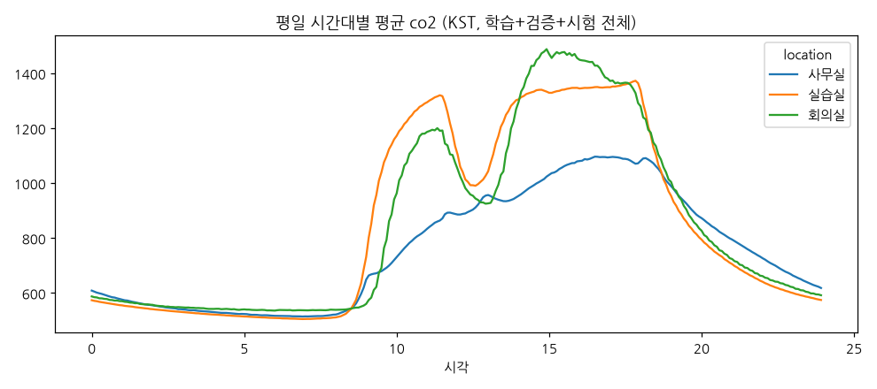
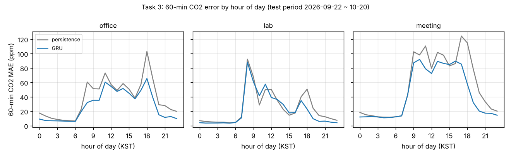
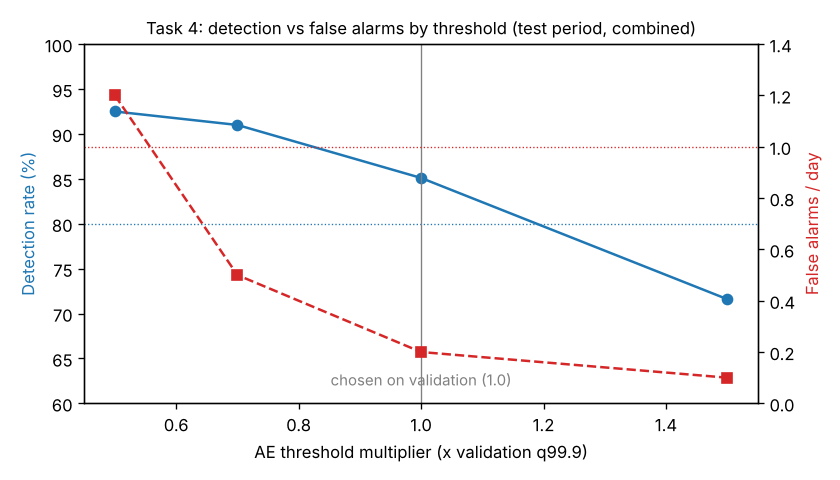

# 시계열 데이터 추론 실습 결과 보고서

**강성찬 (AIGJ_01_001)**. 팀 Jetson `aip-1-3`(Tailscale 100.108.186.17), 저장소 `AIP-1-3/jetson_AIGJ_01_001` collector 브랜치. 트랙 A.
작성 2026-10-20. 최종 갱신 2026-10-22.

## 산출물 위치

| 과제 안내의 산출물 | 위치 |
|---|---|
| 상시 수집 서비스, 수집 현황 보고 | 보드 `~/jetson_AIGJ_01_001` docker compose(collector), `http://100.108.186.17:8090/status`, 아래 과제 1 |
| 데이터 진단서, 기준선 성능표 | [task2-diagnosis.md](task2-diagnosis.md), 아래 과제 2 |
| 예측 모델, 기준선 대비 비교표 | `analysis/task3.py`, 아래 과제 3 |
| 탐지기, 고장 종류별 성적표, 임계값 그래프, 운영 제안 | `analysis/task4.py`, 아래 과제 4 |
| 분류 모델 2종, 혼동 행렬 | `analysis/task5.py`, 아래 과제 5 (사용 여부는 정답 자료가 없어 규칙만) |
| 사전학습 모델 비교표, 채택 의견 | 아래 과제 6 |
| 최적화 보고서 | 아래 과제 7 |
| **예측 서비스 v1**, 12시간 가동 기록 | MQTT `100.108.186.17:1884`, 조회 API `http://100.108.186.17:8091`, 아래 과제 8 |
| **결과 형식 문서** | [service-api.md](service-api.md) (토픽·필드·단위·예시) |
| 발표 원고 | [PRESENTATION.md](PRESENTATION.md) |
| 원본 결과 파일(보드 실행) | [figures/raw/](figures/raw/) |

## 측정 조건 (모든 표 공통)

| 항목 | 값 |
|---|---|
| 데이터 | **실데이터**. 강사 InfluxDB `iot-bucket`(읽기 전용) 2025-09-15 ~ 2026-10-20, 5분 칸으로 정리 |
| 분할 | 학습 ~ 2026-08-25, 검증 2026-08-25 ~ 09-22, **시험 2026-09-22 ~ 10-20** (정규화·임계값·모델 선택은 학습·검증만 사용) |
| 공간 | 실습실, 사무실, 회의실(CO₂·온도·습도), 사무실 밖·창고(온도·습도). 강사 결정에 따라 실제 데이터의 공간을 씀 |
| 보드 | Jetson Orin Nano Super Dev Kit, L4T R39.2.1(JetPack 7.2.1), TensorRT 10.16, 전력 모드 MAXN_SUPER, 클럭 고정 안 함(sudo 없음) |
| 고장 정답 | 실데이터에 없음 → 시험 기간에 5종을 직접 주입(과제 4) |
| 일정 자료 | 없음 → 공휴일 달력과 CO₂ 상승 시각으로 대신함(과제 2·3·5에 영향) |

## 확인 기준 요약

| 과제 | 기준 | 결과 | 판정 |
|---|---|---|---|
| 1 수집 | 24시간 커버율 95%, 브로커·재부팅 후 자동 재개 | 24시간(10-20 06:48 ~ 10-21 06:48 UTC) 1분 센서 99.1~99.3%, 회의실 97.9%. 1분 센서 빈 구간은 정지 시험뿐. 재부팅 뒤 사람 손 없이 수집·서비스 재개 | 통과 |
| 2 기준선 | 학습 기간 정규화, 같은 시점 평가 | 가장 강한 기준선 = 현재값 유지 | 충족 |
| 3 예측 | 60분 CO₂ 30% 감소 / 온도 개선 | CO₂ **22.9%** / 온도 **23.8%** | CO₂ 미달, 온도 통과 |
| 4 이상 탐지 | 결합 탐지율 80%, 헛경보 하루 1회 | **85.1%**, **0.18회** | 통과 |
| 5 환기 경보 | 재현율 85%, macro-F1 > 규칙 | 90.6%, 0.608 vs 규칙 0.614 | F1 미달 |
| 5 사용 여부 | 관찰 기준 F1 | 일정·관찰 자료 없음 | 평가 못 함 |
| 6 사전학습 | 4가지 근거 비교 | 정확도·적중률·지연·메모리 표 | 충족 |
| 7 최적화 | CO₂ 차이 1ppm, 판정 뒤집힘 0.1% | 0.462ppm, 0% | 통과 |
| 8 서비스 | 12시간 무중단, 끊김 경보 | 23.1시간 1,386주기 실패 0, 2분 넘게 빈 구간 0, 평균 1.40초·p95 1.81초. 수집기 10분 정지 때 모든 공간 data_gap → 재시작 후 해제. 재부팅 뒤 부팅 23초 만에 자동 재개 | 통과 |

---

## 과제 1. 데이터 수집 체계

- 구조: MQTT(ChirpStack LoRaWAN) → 수집기 → 원본 jsonl.gz + 디스크 큐 → 보드 로컬 InfluxDB(`127.0.0.1:18086`). 현황은 `:8090/status`. 자세한 내용 [collector.md](collector.md).
- 설정만 바꿔 대응: 토픽·시각·필드 위치가 `config/collector.yaml` 에 있다. 예: `object.co2` → `object.co2_ppm` 으로 바뀌면 `extra_fields` 한 줄 추가 후 재시작.
- 시각: 서버 수신 시각(`nsTime`)을 저장한다. 게이트웨이 한 대의 시계가 약 4분 55초 빨라서, 메시지의 `time` 을 쓰면 그 게이트웨이 측정이 5분 미래에 찍힌다.
- 공용 `iot-bucket` 에는 쓰지 않는다. 같은 원천을 두 수집기가 받으므로, 두 저장소 커버율을 비교해 결측이 수집기 탓인지 센서 탓인지 가린다.
- 24시간 커버율 (2026-10-20 06:48 ~ 10-21 06:48 UTC, 보드 로컬 InfluxDB, `collector.report --hours 24`). 기대 개수 = 24시간 ÷ 센서 보고 주기.

| 공간 | 보고 주기 | 커버율 | 빈 구간 |
|---|---|---|---|
| 실습실·사무실·사무실 밖 | 1분 | 99.1~99.3% | 10-21 04:00~04:12 (수집기 정지 시험) 하나뿐 |
| 회의실 | 10분 | 97.9% (141/144) | 값 하나씩 빠짐(19분 빔): 10-20 13:58, 23:38, 10-21 03:58(정지 시험) |
| 창고 | - | 값 없음 | 센서가 시험 기간 전부터 값을 보내지 않음(수집기 문제 아님) |

- 회의실 빠짐 2건은 정지 시험 밖이다(05:43 기준 집계에서는 10-20 06:18 도 있었음). [가능성 높음] LoRaWAN 무선 손실(10분 주기 센서는 한 번 놓치면 20분 빔). 같은 시각 공용 `iot-bucket` 에도 없으면 센서·무선 탓, 있으면 수집기 탓으로 가린다(미확인).
- 정지 시험 뒤 수집기는 재시작 1분 안에 모든 1분 센서를 다시 받았다(과제 8 장애 시험 표).
- 브로커 재시작 시험은 하지 못했다. 원천 브로커(`data.withio.net`)는 강사 쪽 장비라 껐다 켤 권한이 없다. 대신 수집기는 연결이 끊기면 지수 백오프로 재접속하고(`mqtt_reconnects` 로 횟수 노출), 보드 재부팅 시험에서 부팅 뒤 접속·수신까지 사람 손 없이 이뤄짐을 확인했다.
- 재부팅 시험 (2026-10-21, UTC, 관리자 계정으로 `sudo reboot`, 그 뒤 아무 명령도 실행하지 않음):

| 시각 | 일 |
|---|---|
| 06:48:48 | 재부팅 전 마지막 수신 |
| 06:48:53 | 재부팅 명령 |
| 06:51:46 | 부팅 완료(커널 시작) |
| 06:52:09 | 컨테이너 4개(collector·influxdb·mqtt·infer) 자동 시작 (`restart: unless-stopped`), infer 1주기 성공 |
| 06:52:18 | 수집 재개, 06:52:33 InfluxDB 쓰기 성공 |

- 수집이 빈 시간은 약 3분 30초(06:48:48 → 06:52:18)이고 전부 보드가 꺼져 있던 시간이다. 재개 후 오류·중복·파싱 실패 0, MQTT retained 토픽 6개 그대로.
- **문제점**: 이 재부팅은 보드를 같이 쓰는 다른 팀과 미리 맞추지 않고 했다. 그 결과 다른 팀 컨테이너도 함께 꺼졌다. ts-influxdb·grafana-tsinfer-mskim 은 부팅 뒤 저절로 다시 떴지만, ts-mosquitto 는 꺼진 채(Exited (128)) 남았다(16:42 KST 확인). 원인(읽기 전용으로 확인): 그 컨테이너는 1883 포트를 Tailscale 주소(100.108.186.17)에 묶는데, 부팅 직후에는 그 주소가 아직 없어 바인드에 실패한다. 재시작 정책이 있어도 이 경우는 되살아나지 않는다. 우리 컨테이너는 0.0.0.0 에 묶어서 같은 문제가 없었다. 다시 켜는 것은 그 컨테이너 주인의 판단에 맡겼다. 앞으로 공용 보드의 재부팅 시험은 팀 합의 일정에만 하고, 평소에는 `systemctl is-enabled docker`·컨테이너 재시작 정책 확인 같은 읽기 전용 점검으로 대신한다.

## 과제 2. 데이터 이해와 기준선

전문: [task2-diagnosis.md](task2-diagnosis.md). 핵심만:

*그림: 평일 시간대별 평균 CO₂(KST, 2025-09-15 ~ 2026-10-20 전체, 5분 칸). 사람이 있으면 오르고 없으면 내려간다: 09시 전후 상승(출근·수업 시작), 12~13시 하강(점심), 13시 이후 재상승, 18시 이후 퇴실 하강. 온도 그림은 [figures/pattern_temperature.png](figures/pattern_temperature.png).*

- 일정 변화에 대한 CO₂ 반응(시간표가 없어 '그날 새벽보다 100ppm 오른 첫 시각'으로 봄): 실습실 평일 273일 중 248일 상승, 중앙값 08:45~08:50. 사무실 233일 중 220일, 08:55~09:00. 회의실 273일 중 243일, 09:25~09:37. 실습실은 9시 수업 기준 **10~15분 전부터** 오르기 시작한다(입실이 수업보다 먼저). 점심은 12시부터 약 1시간 동안 평균 300ppm 내려가고, 회의실은 13시 이후 오후가 오전보다 높다(오후 회의가 더 길거나 많음) [가능성 높음].
- 일정과 어긋나는 날: 오르지 않은 평일은 대부분 공휴일(설·추석 연휴, 대체공휴일, 지방선거일)이고, 실습실만 9/23·9/28~30 에 비어 있었다(이유 미확인). 회의실은 공휴일이 아닌 날(10/14, 10/19)에도 빈다.

| 공간 | 60분 CO₂ MAE, 현재값 유지 | 1시간 평균 | 어제 같은 시각 | 과제 3 통과선 |
|---|---|---|---|---|
| 실습실 | 24.4 | 31.8 | 91.3 | 17.1 |
| 사무실 | 37.6 | 49.5 | 125.9 | 26.3 |
| 회의실 | 55.6 | 69.7 | 160.3 | 38.9 |

*조건: 실데이터, 시험 기간 2026-09-22 ~ 10-20, 5분 칸, 공간 평균. 보드 CPU.*
- 현재값 유지가 가장 강하다. CO₂ 는 느린 값이라 1시간 안에는 지금 값과 크게 다르지 않고, 오차는 수업·회의가 시작·끝나는 순간에 몰린다.
- '어제 같은 시각'은 지금을 보지 않아 시점과 관계없이 오차가 같고, 월요일·공휴일 다음 날에 빈 방을 베낀다. 시험 기간에 추석·대체공휴일·한글날이 몰려 특히 불리하다.
- 진단 중 고친 것: 10분 주기 센서 때문에 회의실 칸이 전부 비던 문제, 2℃ 낮은 센서가 들락날락해 실습실 평균이 톱니가 되던 문제(장비별 5분 칸 → 공간 평균으로 바꿈).

### 최근 1주 관찰 (2026-10-15 ~ 10-21)

*조건: 공용 `iot-bucket` CO₂ 원본(우리 수집기 저장소가 아님), 2026-10-15 00:00 ~ 10-22 00:00 KST 7일(주말 포함), 0 < 값 < 5,000 만 사용, **15분 평균**(7일 × 5분 × 전체 센서는 조회가 시간 초과), 초과 비율·최고값·시간대는 공간 안 센서 평균(실습실 4대, 사무실·회의실 1대). 보드에서 `analysis/recent_week.py` 로 계산(2026-10-22 09:35 KST), 원본 [figures/raw/recent_week/](figures/raw/recent_week/).*

| 공간 | 1,000ppm 초과 칸 비율 | 7일 최고(15분 평균) | 평일 시간대별 평균 봉우리 |
|---|---|---|---|
| 회의실 | **6.0%** (40/669칸) | **2,874ppm** (10/15 17:15) | 17시 1,212ppm(16~18시 1,000 이상) |
| 사무실 | 5.8% (39/672) | 1,366ppm (10/15 18:30) | 18시 975ppm(09시부터 계속 올라 18시까지 유지) |
| 실습실 | 1.2% (8/672) | 1,033ppm (10/19 15:00) | 14시 942ppm(11시 892 → 12시 758 점심 하강 → 14~15시 재상승) |

- [확실] 회의실이 가장 높이, 가장 빨리 간다(1인 센서 기준 2,874ppm, 평일 16~18시 평균이 1,000 이상). 실습실은 평균 봉우리가 942ppm 으로 1,000 을 거의 넘지 않는다. 시험 기간 전체 패턴(위 그림)과 같은 결론이고, **환기 선제 경보의 가치가 가장 큰 공간은 회의실**이다.
- [확실] **같은 실습실 센서 4대의 밤(02~05시) 기준선이 543·547ppm 과 440·427ppm 으로 최대 120ppm 차이**가 난다. 외기 약 420ppm 이므로 낮은 두 대가 맞고 높은 두 대가 영점이 틀어진 쪽으로 보인다 [가능성 높음]. 과제 4 '영점 틀어짐'이 실데이터에 이미 들어 있는 셈이고, 공간 평균을 쓰는 우리 파이프라인에서는 희석된다.
- 수치 검증에서 드러난 것: 같은 기간을 먼저 Mac Grafana 패널로 봤을 때 실습실 초과 비율이 3.1% 로 나왔는데, 보드에서 공간 평균으로 다시 계산하니 1.2% 다(회의실·사무실은 6.0%·5.8% 로 같음). [가능성 높음] 패널 쪽은 센서별 칸을 공간 평균 없이 세었고, 영점이 120ppm 높은 두 대가 1,000 을 자주 넘겨 비율을 끌어올렸다. 센서 하나짜리 공간은 차이가 없는 것이 그 증거다. **센서별 '기준 초과 비율'은 밤 기준선을 뺀 뒤 비교해야 공정하다**(한계 참고).

## 과제 3. 60분 예측

모델: GRU(과거 2시간, 12칸 변화량을 한 번에 출력), 입력에 시각·요일·**공휴일**·하루 전/일주일 전 같은 시각의 변화. 공간·항목·시점마다 **검증 기간** MAE 로 GRU 변형·현재값 유지·가중 평균 중 하나를 골랐다(시험 기간은 한 번만 평가).

| CO₂ MAE(ppm, 공간 합산) | 5분 | 15분 | 30분 | 60분 |
|---|---|---|---|---|
| 현재값 유지 | 7.8 | 15.6 | 23.8 | 39.1 |
| GRU(달력 포함) | 7.7 | 13.8 | 19.7 | 30.9 |
| GRU(달력 제외) | 7.6 | 13.2 | 19.4 | 32.1 |
| **검증 기간으로 고른 것** | 7.4 | 13.2 | 19.4 | **30.2** |

| 온도 MAE(℃) | 60분 |
|---|---|
| 현재값 유지 | 0.155 |
| 고른 것 | **0.118** |

*조건(두 표 공통): 실데이터, 시험 기간 2026-09-22 ~ 10-20. CO₂ 는 실습실·사무실·회의실 합산, 온도는 5공간 합산. 학습 ~08-25, 검증 08-25 ~ 09-22 로만 선택. 보드 CPU(PyTorch).*

공간별 60분 CO₂: 사무실 26.3%, 회의실 21.5%, 실습실 20.8% 감소.

*그림: 시각별 60분 CO₂ MAE(시험 기간). 오차가 가장 큰 시각은 실습실 08시(GRU 87.7 vs 현재값 유지 92.3ppm), 회의실 10시(92.0 vs 98.1)와 16시(89.6 vs 86.2), 사무실 18시(65.5 vs 103.0). 즉 **사람이 들어오기 직전**과 회의가 시작하는 시각이다. 사무실 퇴실(18시)은 GRU 가 크게 이기는데, 퇴실 시각은 규칙적이라 달력만으로 맞힐 수 있기 때문이다.*

해석
- [확실] 30% 를 못 넘은 가장 큰 원인은 **'곧 사람이 들어온다'는 정보가 입력에 없다**는 것이다. 오차가 수업·회의 시작 직전에 몰리고, 과거 센서값에는 그 신호가 없다.
- [확실] 쉬는 날에는 GRU 가 현재값 유지보다 나빴다(1차 실행, 실습실 11.6 vs 4.9ppm). 공휴일 표시를 넣고, 검증 기간 선택으로 실습실·회의실은 GRU 0.75 + 현재값 0.25 를 쓰게 되었다.
- 달력 정보의 가치: 달력을 넣으면 60분 CO₂ 오차가 **1.2ppm 줄어든다**(32.1 → 30.9). 반면 사무실 밖 온도는 달력을 빼는 쪽이 낫다(0.216 vs 0.432℃, 1차). 바깥 온도는 사람이 아니라 날씨를 따르기 때문으로 보인다 [가능성 높음].
- 일정 자료가 있으면 `--schedule` 로 다시 학습할 수 있게 코드는 준비돼 있다(이번 제출에서는 쓰지 않음).

## 과제 4. 이상 탐지

- 오토인코더: 1시간 창 x CO₂·온도·습도, 학습 기간으로 학습. 임계값 = 공통 배율 x 항목별 검증 기간 99.9% 분위, 배율은 검증 기간 경보가 전체 하루 0.4회 이하가 되는 가장 작은 값.
- 규칙: 튄 값, 값 고정, 새벽 기준선, 상승 폭(그날 새벽 대비 상승이 같은 요일 종류·시각의 평소 99% 분위 + 여유 초과). 기준값도 검증 기간에서 전체 하루 0.5회 이하가 되게 정함.
- 시험 기간에 고장 67건 주입(공간 x 종류마다 최대 4건, 값이 있는 칸에만).

| 고장 | 모델 | 규칙 | 결합 |
|---|---|---|---|
| 튄 값 | 9/16 | 16/16 | 16/16 |
| 값 고정 | 2/16 | 16/16 | 16/16 |
| 영점 틀어짐 | 2/12 | 5/12 | 7/12 |
| 냉방 정지 | 12/12 | 0/12 | 12/12 |
| 환기 정지 | 4/11 | 2/11 | 6/11 |
| **전체** | 29/67 (43%) | 39/67 (58%) | **57/67 (85.1%)** |
| 헛경보(하루) | 0.0 | 0.1 | **0.18** |

*조건: 실데이터 시험 기간 2026-09-22 ~ 10-20 에 고장 5종 67건을 직접 주입(실데이터에 고장 정답 없음). 임계값·규칙 기준은 검증 기간에서만 정함. 헛경보는 주입하지 않은 시각의 경보를 전체 공간 합으로 셈.*
임계값 배율(모델만 바꿈)에 따른 결합 성적: 0.5배 92.5% / 1.2회, 0.7배 91.0% / 0.5회, 1.0배 85.1% / 0.2회, 1.5배 71.6% / 0.1회. 이 표는 시험 기간 결과라 **배율을 고르는 데 쓰지 않았다**.

*그림: 배율 0.5~2.0 의 8개 점(sweep.csv). 배율을 낮추면 탐지율과 헛경보가 함께 오른다. 모델만의 탐지율(점선)은 1.25 이상에서 24% 아래로 떨어져 규칙이 거의 다 맡게 된다. 검증 기간 예산(하루 0.4회)으로 고른 1.0 이 두 기준(80%, 1회/일)을 모두 만족하는 구간 안에 있다.*

해석
- 모델이 못 잡는 것: **값 고정**(2/16). 정상 범위의 값에서 멈추면 1시간 창의 모양이 '조용한 정상'과 같아 복원 오차가 작다. 규칙(같은 값이 이어짐)이 맡는다.
- 규칙이 못 잡는 것: **냉방 정지**(0/12). 온도가 몇 도 서서히 오르는 것은 튄 값도, 고정도 아니고, 온도용 상승 규칙이 없다. 모델은 'CO₂ 가 오르는데(사용 중) 온도도 오름'이라는 항목 간 관계가 깨진 것을 본다.
- 영점 틀어짐·환기 정지가 약한 이유: 수 시간에 걸친 느린 변화라 1시간 창에는 작게 보인다. 실습실은 새벽 기준선과 상승 폭 규칙이 검증 기간에 너무 자주 울려서 꺼졌다(실제로 새벽에도 CO₂ 가 높은 날이 있음).
- 1차 실행(규칙 기본값)은 탐지 74.6%, 헛경보 2.29회로 미달이었다. 규칙이 고장 없는 검증 기간에 하루 3.8회 울렸고, 모델은 공간·항목마다 예산을 나눠 한 몫이 1건 미만이 되면서 너무 둔해졌다. **기준을 검증 기간 예산으로 합쳐 정하는 것**이 가장 큰 개선이었다.
- 운영 제안 [가능성 높음]: 값 고정·튄 값·데이터 끊김은 설비 담당에게 즉시 보낸다(지연 5~30분, 원인 항목 100% 맞음). 냉방 정지 의심(모델, 지연 중앙값 약 3.5시간)은 냉난방 담당에게 하루 요약으로 보낸다. 회의실 온도 값 고정 규칙은 센서 분해능 때문에 검증 기간에 91회 울려 꺼 두었으니, 회의실 온도 센서 점검을 권한다.
- 빈 방의 환기 정지: CO₂ 를 만드는 사람이 없어 센서값이 변하지 않으므로 탐지할 수 없고, 사람이 없으니 급하지도 않다. 첫 사용 때 상승 폭 규칙으로 잡는 것이 현실적이다.

## 과제 5. 상태 추정

### 환기 선제 경보 (30분 안에 1000ppm 초과)

양성 비율: 학습 2.56%, 검증 3.11%, 시험 1.11%. 이미 1000 이상인 시각은 평가에서 뺐다(늦은 경보라 '선제'가 아님).

| 방법 | 재현율 | 정밀도 | macro-F1 |
|---|---|---|---|
| **MLP(최근 1시간, 검증 기간에서 고름)** | **0.906** | 0.143 | **0.608** |
| MLP(+하루·일주일 전) | 0.869 | 0.180 | 0.637 |
| 규칙 CO₂ ≥ 850 | 0.845 | 0.151 | 0.614 |
| 규칙 CO₂ ≥ 730(검증 기간에서 고름) | 0.935 | 0.077 | 0.537 |

*조건: 실데이터, 시험 기간 2026-09-22 ~ 10-20, 5분 칸 22,067개(실습실·사무실·회의실), 이미 1000ppm 이상인 시각 제외. 임계값·입력 선택은 검증 기간만 사용.*

혼동 행렬 (행 = 실제, 열 = 판정; 양성 = 30분 안에 1000ppm 초과, 245칸 = 1.11%)

| MLP(채택) | 경보 | 경보 없음 | | 규칙 CO₂ ≥ 850 | 경보 | 경보 없음 |
|---|---|---|---|---|---|---|
| **실제 양성** | 222 | 23 | | **실제 양성** | 207 | 38 |
| **실제 음성** | 1,329 | 20,493 | | **실제 음성** | 1,165 | 20,657 |

- 가장 많이 헷갈리는 칸은 둘 다 '실제 음성인데 경보'(헛경보 1,329 vs 1,165)다. 정밀도 14~15%: 경보 7번 중 6번은 넘지 않는다. '항상 아님'의 정확도가 98.9% 로 가장 높게 나오므로 정확도는 지표로 쓸 수 없다.
- 하루·일주일 전 입력 모델은 헛경보 972, 놓침 32 로 두 모델 중 헛경보가 적지만(macro-F1 0.637), 검증 기간에서 졌기 때문에 채택하지 않았다.
- [확실] 재현율은 통과, macro-F1 은 규칙보다 0.006 낮아 미달.
- 하루·일주일 전 입력 모델이 시험 기간에 규칙을 이기지만, 검증 기간 선택(0.767 vs 0.772)에서 졌으므로 채택하지 않았다. **시험 결과를 보고 바꾸면 누수**이고, 차이도 시험 기간 표본 변동 범위 안이다 [가능성 높음].
- 가장 많이 틀린 경우: 헛경보는 실습실 9~14시(수업 중 850~1000ppm 을 오래 유지하다 넘지 않음), 놓친 경보는 회의실 10·13·14시(회의 시작 직후 빠르게 오름). 둘 다 '곧 사람이 늘어난다/줄어든다'는 일정 정보가 없어서 생긴다.
- 검증 3.11% → 시험 1.11% 로 양성이 줄었다(추석·공휴일). 검증 기간에 맞춘 임계값이 시험 기간에는 너무 민감해져 정밀도가 낮다.

### 사용 여부 추정
- 일정·직접 관찰 자료가 없어 정답을 만들 수 없어 평가하지 못했다. 코드는 준비됨(`--schedule`, `--observed`).
- 대신 규칙(최근 15분 CO₂ +30ppm = 사용중)의 결과를 서비스에서 낸다.

## 과제 6. 사전학습 모델 비교 (Chronos-Bolt small, 추가 학습 없음)

| 60분 CO₂ MAE | 공간 합산 | 실습실 | 사무실 | 회의실 |
|---|---|---|---|---|
| 현재값 유지 | 39.3 | 24.4 | 37.7 | 55.9 |
| Chronos(과거 43시간) | 35.7 | 19.1 | 33.5 | 54.8 |
| GRU | **31.0** | 21.5 | **27.8** | **44.0** |
| GRU+Chronos 평균 | 31.1 | **17.9** | 29.1 | 46.5 |

*조건: 실데이터 시험 기간 2026-09-22 ~ 10-20, 같은 시점에서 세 방법 비교. Chronos-Bolt small, 추가 학습 없음, 보드 CPU.*
- 예측 구간(10~90%) 적중률: 과거 24시간 이상이면 78~83%(이상적 80%), 2시간이면 60분에서 72.5%.
- 비용(보드 CPU): 불러오기 8.6~17.9초, 호출 74~413ms(부하에 따라), 최대 RSS 412MB~1GB. GRU 는 ONNX Runtime 0.2~0.4ms.
- **채택 의견**: 서비스의 점 예측에는 쓰지 않는다. GRU 가 더 정확하고 수백 배 빠르다. 다만 학습 없이 현재값 유지를 9% 이기고 구간 적중률이 맞으므로, (1) 새 공간처럼 학습 자료가 없을 때의 임시 예측, (2) '예측 구간'이 필요한 곳(경보 확신도)에는 쓸 만하다. 실습실처럼 규칙적인 공간에서는 GRU 와 평균하면 더 낫다(17.9 vs 21.5).

## 과제 7. 엣지 최적화

| 모델 | PyTorch CPU | ONNX Runtime CPU | TensorRT FP16 (GPU) | 차이(FP16, PyTorch 기준) |
|---|---|---|---|---|
| GRU | 17.4 ms (p95 67.5) | **0.21 ms** (p95 0.23) | 0.75 ms | CO₂ 최대 0.462ppm, 평균 0.028 |
| 오토인코더 | 0.70 ms (p95 0.83) | **0.025 ms** (p95 0.026) | 0.066 ms | 판정 뒤집힘 0% |
| 환기 MLP | 0.54 ms (p95 1.50) | **0.041 ms** (p95 0.025) | 0.064 ms | 판정 뒤집힘 0% |

배치 4(네 공간 한꺼번에, CPU): GRU PyTorch 13.6 ms(p95 42.7) / ONNX Runtime 0.52 ms(p95 0.54), 오토인코더 0.64 / 0.027 ms, 환기 MLP 0.46 / 0.025 ms. 메모리(RSS)는 PyTorch 696MB, ONNX Runtime 715MB 로 거의 같다(둘 다 Python 프로세스 자체가 대부분). 원본: [figures/raw/task7/latency_cpu.csv](figures/raw/task7/latency_cpu.csv).

*조건: 보드 Jetson Orin Nano Super, 전력 모드 MAXN_SUPER, 클럭 고정 안 함, 배치 1. 워밍업·반복 횟수는 아래 줄. 입력은 시험 기간 실데이터.*
배치 1, 평균. PyTorch GPU 는 측정하지 못했다: 분석 이미지가 CPU 전용 PyTorch 라 GPU 실행은 TensorRT 로만 쟀다. 조건: 워밍업 50회 + 500회(CPU), trtexec 워밍업 2초 + 1000회(GPU, 입출력 복사 포함). 대기 전력 VDD_IN 6.8W, TensorRT 실행 중 7.2~7.8W. 2차 측정값(보드가 덜 바쁠 때). 1차에는 PyTorch GRU 가 104ms 로 부하에 크게 흔들렸다.

결론
- 이 크기 모델에서는 **ONNX Runtime CPU 가 가장 빠르다**. TensorRT 는 GPU 실행·복사 비용이 계산보다 커서 오히려 느리다.
- 그래도 변환하는 이유: PyTorch 는 p95·최대 지연이 평균의 4~7배로 흔들린다(67~113ms). 상시 서비스에서는 느린 쪽 5% 가 다음 주기와 겹치는지를 정하므로, 흔들림이 작은 ONNX Runtime 을 쓴다. GPU 는 모델이 커지거나 공간·모델 수가 늘 때 남겨 둔다.

## 과제 8. 상시 추론 서비스

- 매분 공간마다 60분 예측, `co2_over_1000_in_min`, 이상 점수·원인 항목·규칙 경보(data_gap, stuck, spike, night, rise, out_of_range), 사용 여부, 환기 경보를 계산.
- 제공: MQTT `100.108.186.17:1884`(읽기 전용, retained), 조회 API `http://100.108.186.17:8091`. 형식: [service-api.md](service-api.md).
- 전처리: 학습과 **같은 함수**(`prep.clean`, `prep.to_grid`)를 import 한다. 막 시작된 5분 칸은 쓰지 않는다. 다르면 1분 평균과 5분 평균의 잡음 크기, 센서 섞임 톱니 같은 분포 차이로 예측·이상 점수가 조용히 틀어진다.
- 경보: 켜짐 → 켜져 있는 동안 30분마다 → 꺼짐 한 번. 매분 보내지 않는다.
- 가동 기록: 2026-10-20 16:42 KST 시작, 10-21 10:17 KST 까지 1,055주기 오류 0, 주기당 1.2~1.9초. 10-20 16:46~16:50 KST 에는 같은 MQTT 클라이언트 ID 를 쓴 시험 실행이 겹쳐 발행 연결이 끊겼다 붙었을 수 있다(계산은 정상). 
- 가동 기록 요약(`analysis.service_report --since 2026-10-20T07:42Z --exclude 2026-10-20T07:46Z/2026-10-20T07:51Z`): 10-21 06:48 UTC 까지 23.1시간 1,386주기, 실패 0, 2분 넘게 빈 구간 0, 주기 처리 시간 평균 1.40초·p95 1.81초·최대 5.02초(읽기 0.14초, 계산 1.26초). 데이터 끊김 경보는 정지 시험(13:08~13:18 KST)과 회의실 값 빠짐 2번(각 10분 뒤 해제)뿐, 창고는 기간 내내 끊김.

### 장애 시험: 수집기 10분 정지 (2026-10-21, UTC)

| 시각 | 일 |
|---|---|
| 04:00:34 | 수집기 정지. 마지막 수신: 사무실·사무실 밖·실습실 04:00, 회의실 03:57(10분 주기 센서) |
| 04:08:05 | 회의실 data_gap (마지막 값 뒤 10분) |
| 04:10:05 | 사무실 밖 data_gap |
| 04:11:05 | 사무실·실습실 data_gap → 모든 공간 경보 |
| 04:11:34 | 수집기 재시작 |
| 04:12:05 ~ 04:18:05 | 사무실 밖·실습실(04:12) → 사무실(04:13) → 회의실(04:18, 다음 10분 값) 해제 |

- 서비스는 멈추지 않았다: 1218 → 1239주기, 오류 0, 주기당 1.5~1.8초.
- 경보는 공간마다 '마지막 값 + 10분'에 켜진다. 센서 주기가 다른 회의실이 3분 먼저 울린 이유다.
- **찾은 문제**: 끊긴 동안 실습실 `anomaly:temperature` 헛경보가 났다. 오토인코더의 1시간 창에 빈 칸·메운 값이 섞여 복원 오차가 커졌기 때문이다. → 끊긴 동안과 복구 뒤 1시간(창이 다시 찰 때까지)은 이상 판정을 멈추고 `anomaly.paused=true` 로 알리게 고쳤다(a33ebca, 다음 재시작 때 반영).
- 창고 data_gap 은 시험과 무관하게 계속 켜져 있다. 창고 센서는 시험 기간 전부터 값이 없다.

## 원본 자료

보드에서 만든 결과 파일 원본은 [figures/raw/](figures/raw/) 에 과제별로 있다(report.md, 성적표 CSV, 임계값·규칙 기준 JSON). 발표 원고는 [PRESENTATION.md](PRESENTATION.md).

## 한계

- 과제 3 CO₂ 60분 예측은 22.9% 개선으로 목표 30%에 못 미쳤다. 과제 5 환기 경보는 macro-F1 0.608 로 규칙(0.614)을 넘지 못했다. 둘 다 수업 시간표·회의실 예약 같은 재실 일정 자료 없이 공휴일 달력과 CO₂ 상승 시각으로 대신한 결과다.
- 시험 기간 결과를 보고 모델·임계값을 다시 고르지 않았다(과제 5 lag 변형은 시험 0.637 이었지만 검증에서 져서 채택하지 않음).
- 과제 4 고장 정답은 실데이터에 없어 직접 주입한 5종으로만 평가했다.
- 실습실 9/23·9/28~30 미사용 이유는 확인하지 못했다.
- 실습실 센서 4대의 밤 기준선이 최대 120ppm(427~547ppm) 차이 난다(최근 1주 관찰). 공간 평균으로 학습·평가해 영향은 줄였지만, 과제 4 '영점 틀어짐' 주입 실험은 이미 영점이 틀어진 센서 위에 다시 주입한 것이고, 센서별 기준 초과 비율은 보정 전에는 센서 간 비교가 공정하지 않다(같은 7일 실습실 초과 비율이 센서별 집계 3.1% vs 공간 평균 1.2%). 보정값을 모르므로 밤 기준선(02~05시 중앙값) 차이를 그 추정치로 쓸 수 있다. 재계산은 `docker compose run --rm lab python -m analysis.recent_week`.
